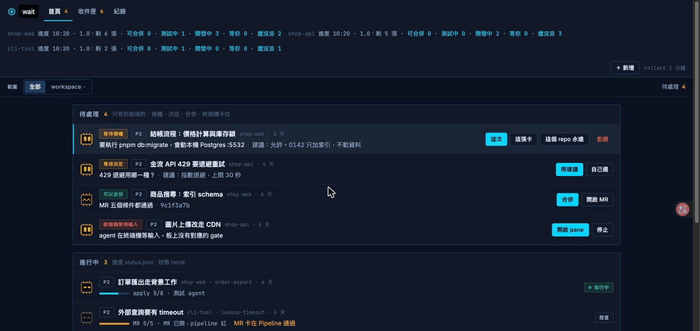

# opsx-workflow

A Claude Code plugin that runs a change from inbox card to pull request, with a board to watch it, and leaves the merge to a human.

## 示範



看板顯示每張卡現在在哪一站、哪裡卡住在等你。示範資料是虛構的三個專案（shop-web、shop-api、cli-tool）。

## 為什麼做

- 用 Claude Code 同時做好幾件事時，最難的不是寫 code，是記得每件事做到哪、哪個 agent 在等我回答。
- 每次都從頭跟 agent 講規矩（先想清楚、先寫測試、不要碰 main）很累。這些規矩該寫進流程，不該靠記得。
- 讓 agent 自己跑可以，但合併是最後一道人工關卡，不能讓 agent 代按。

## 功能重點

- **一條固定流程**：收件 → explore → grill → propose → apply → review → pr → babysit → archive，每一站是一個 skill，產出一份落在 `openspec/changes/<卡>/` 的文件。
- **先寫測試**：apply 每條 task 先寫測試、看它紅，再寫 code。review 在測試沒綠、task 沒測試時拒絕開始。
- **大卡自動拆**：太大的卡拆成 session、主 change、子 change，確認一次後照 workplan 自動做，見 [references/work-split.md](references/work-split.md)。
- **看板**：herdr 裡的網頁與右側 pane，顯示待處理、進行中、待指派、已完成與收件匣，按鈕背後都有對應的 `opsx` 子命令。
- **授權閘門**：agent 做到需要你決定或授權的事就寫一筆 gate 然後繼續做別的，不在終端機乾等。
- **背景派工與自動接力**：`opsx dispatch` 開 worktree 與 pane 派給 agent；`opsx coordinate` 定時收尾已合併的卡、重派死掉的卡。

## 快速開始

需要 Claude Code 2.1.275 以上（並在 Claude Code 設定開啟沙盒，下面的安全模型靠它）、Python 3.11 以上、openspec CLI（`npm i -g @fission-ai/openspec`）、`gh` 或 `glab`（開 PR 與 MR），看板與派工另外需要 herdr。定時同步與 `opsx coordinate` 的排程只在 macOS（launchd）裝得起來。

```
/plugin install opsx-workflow --marketplace Mikaelaaaaa/opsx-workflow
```

裝完在終端機跑一次全域初始化，再到每個要用的 repo 根目錄初始化：

```
bash <plugin root>/bin/opsx init --global
opsx init
```

然後 `opsx new -- "一句話說你要做什麼"` 開一張收件卡，在看板按派工，或自己在 Claude Code 裡跑 `/opsx-workflow:explore <卡>`。

設定檔改了什麼、沙盒與授權檔、herdr socket、新電腦 onboarding 都在 [docs/setup.md](docs/setup.md)。

## 流程


- `explore` 讀 code、列出已知與待決；`grill` 一次問你一題，只問只有你能答的。
- `propose` 寫 proposal、design、spec、tasks；`apply` 照 tasks 先測試後實作，一個 change 一個 commit。
- `review` 三位 reviewer 平行審，Bug 與 Must-fix 退回 apply；`pr` 開 MR 或 PR；`babysit` 看 CI 與 review 留言。
- **合併永遠留給人。** 在看板按「合併」或跑 `opsx merge <卡>`，只寫一次性核准，由 agent 執行那一次合併，agent 自己合不了。
- 沒有 openspec 殼的小想法也可以先 `/opsx-workflow:explore` 隨便聊，想清楚再開卡。

## 看板

資料全是投影（`opsx collect` 從卡的檔案、狀態目錄、herdr 與 MR 狀態算出來），看板自己不存狀態。

- 網頁：herdr 裡叫 action `open-board`，或 `bash herdr-board/scripts/open-board.sh`。
- 右側 pane：herdr 裡叫 action `open-pane`，同一份清單，↑↓ 選、Enter 跳到 pane。
- 收件匣 tab：還沒派出的卡，依來源分組；`opsx sync` 每天把指派給你的 issue 與程式碼裡的 `shortcut:` 註解撈進來。

快捷鍵、收件匣子命令與每日同步見 [docs/setup.md](docs/setup.md)。

## 常用指令

| 指令 | 做什麼 |
|------|--------|
| `opsx init --global` | 裝一次：CLI、狀態目錄、看板 plugin、全域設定 |
| `opsx init` | 在目前 repo 裝 openspec 與 opsx schema |
| `opsx new -- <一句話>` | 開一張收件卡 |
| `opsx dispatch <卡>` | 派給 agent：開 worktree、pane，送出第一句 |
| `opsx answer <卡> --gate <id> <文字>` | 回 agent 留下的 gate |
| `opsx merge <卡>` | 核准合併（一次性，沙盒外執行） |
| `opsx stop <卡>` | 停下派出去的卡 |
| `opsx sync` | 把 issue 與 `shortcut:` 註解撈進收件匣 |
| `opsx lead` | 開協調者 session，回報全部卡的進度 |

完整清單：`opsx --help`。

## 安全模型

- 開啟 Claude Code 沙盒後，agent 在沙盒內跑，只能寫目前 repo、worktree 與 opsx 狀態目錄；opsx 不替你開沙盒。
- 做到 push、開 MR、遷移資料庫這類事，授權閘門先看你給過什麼授權；沒給就寫成 gate 等你回。
- 合併核准存在沙盒內寫不到的位置，只有你在沙盒外（終端機或看板）才寫得進去（同樣要先開沙盒）。
- herdr socket 只有協調者 session 連得到，一般 agent 的 herdr 動作走受限的佇列。

細節與已知沒驗證的地方見 [docs/setup.md](docs/setup.md)。

## 路線圖

- **1.0 全自動**：任一台電腦裝好就能用；卡從收件到 PR 自己跑完，合併留給人。
- **2.0 Orca**：卡的 worktree 在 Orca IDE 裡開得到，驗證過後執行層從 herdr 換成 Orca。
- **補 LICENSE**：專案目前沒有授權檔。
