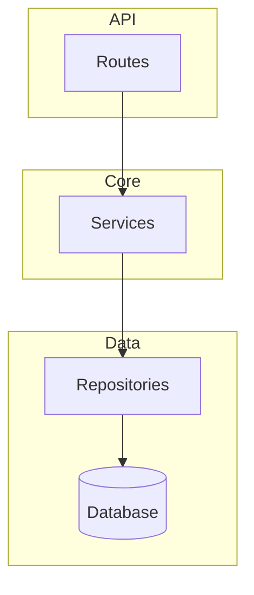

# ARCHITECTURE.md Template

Use this as a structural guide — adapt sections to the project. Not every project needs every section.

## Required sections

### Overview
2-3 sentences: what this project is, what it does, how it's structured at the highest level.

### System Diagram
Mermaid `graph TD` with subgraphs per architectural layer. Keep under 30 nodes.



### Component Map
ASCII art showing directory → role mapping:

```
src/
├── api/            ← API Layer: HTTP handlers
│   ├── routes/
│   └── middleware/
├── services/       ← Core: domain logic
├── models/         ← Data: ORM models
└── utils/          ← Shared: utilities
```

## Optional sections (include when relevant)

### Key Flows
Mermaid `sequenceDiagram` for 1-3 critical request paths.

### Dependencies
Mermaid `graph LR` showing module relationships + external services.

### Tech Stack
Table: Layer | Technology | Purpose

### Conventions
Bullet list of non-obvious project conventions.

### Infrastructure (for infra repos)
Deployment topology, service mesh, environment layout.

### Packages (for monorepos)
Table: Package | Purpose | Dependencies

## Mermaid guidelines

- `graph TD` — architecture overviews (top-down)
- `graph LR` — dependency graphs (left-right)
- `sequenceDiagram` — request flows
- `classDiagram` — data models
- `stateDiagram-v2` — state machines
- Keep under 30 nodes per diagram
- Use subgraphs to group related components

## Manual edit preservation

Wrap user-authored sections in:
```
<!-- manual -->
Content preserved across regeneration
<!-- /manual -->
```
